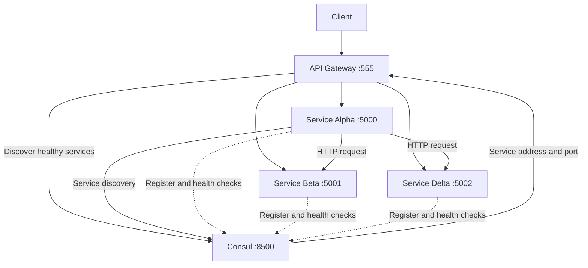

# Service Discovery

A microservices service-discovery project built using **Node.js, Express.js, Docker Compose, and HashiCorp Consul**.

**Roadmap.sh Project:** [Service Discovery](https://roadmap.sh/projects/service-discovery)  
**Source Code:** [GitLab Repository](https://gitlab.com/connect2sazad/service-discovery/)

## Overview

This project demonstrates how microservices can register themselves with a service registry, discover other services dynamically, and communicate without relying on hardcoded IP addresses.

It consists of three dummy services, an API Gateway, and HashiCorp Consul.

### Architecture



## Technology Stack

- Node.js and Express.js
- JavaScript (ES Modules)
- HashiCorp Consul
- Docker and Docker Compose
- Python 3
- AWS EC2 (deployment environment)

## Project Components

### 1. Dummy Services

Three independent services are generated using a shared service template and a Python script.

| Service | Port | Service Name |
|---|---:|---|
| Service Alpha | 5000 | `service-alpha` |
| Service Beta | 5001 | `service-beta` |
| Service Delta | 5002 | `service-delta` |

Each service provides:

- `/` – Health-check endpoint.
- `/info` – Returns the service name and current timestamp.

Example response:

```json
{
  "current_timestamp": 1793472991643,
  "name": "service-alpha"
}
```

Each service automatically registers itself with Consul during startup and periodically reports its health through HTTP health checks.

### 2. HashiCorp Consul

Consul acts as the service registry and discovery mechanism.

It is responsible for:

- Maintaining the service catalog.
- Registering and tracking service instances.
- Performing health checks.
- Returning healthy service instances through its HTTP API.

Consul UI:

```text
http://<EC2_PUBLIC_IP>:8500
```

### 3. API Gateway

The API Gateway provides a single entry point for accessing the services.

It discovers healthy service instances through Consul and forwards incoming requests to the appropriate service.

Gateway endpoints:

| Endpoint | Destination |
|---|---|
| `/service-alpha/info` | Service Alpha |
| `/service-beta/info` | Service Beta |
| `/service-delta/info` | Service Delta |

Gateway URL:

```text
http://<EC2_PUBLIC_IP>:555
```

### 4. Service-to-Service Communication

Service Alpha can dynamically discover and communicate with other services through Consul.

Available endpoints:

```text
http://<EC2_PUBLIC_IP>:5000/discover/beta
http://<EC2_PUBLIC_IP>:5000/discover/delta

http://<EC2_PUBLIC_IP>:5000/communicate/beta
http://<EC2_PUBLIC_IP>:5000/communicate/delta
```

The communication workflow:

1. Alpha receives a request to communicate with another service.
2. Alpha queries Consul for healthy instances.
3. Consul returns the service address and port.
4. Alpha sends an HTTP request to the discovered service.
5. Alpha returns the response to the original caller.

## Setup and Installation

### Prerequisites

- An AWS EC2 instance (Ubuntu recommended).
- Git.
- Python 3.
- Docker Engine.
- Docker Compose plugin.

### Step 1: Connect to your EC2 instance

Create an EC2 instance and connect using SSH.

If you need help creating and connecting to an EC2 instance, check out my [YouTube Playlist on AWS](https://www.youtube.com/playlist?list=PLP-z5YySqpBA).

### Step 2: Clone the repository

```bash
git clone https://gitlab.com/connect2sazad/service-discovery.git

cd service-discovery
```

### Step 3: Generate the services

```bash
python3 gen_services.py
```

This script generates the three dummy services using the shared service template and their respective configurations.

### Step 4: Start the application

```bash
docker compose up -d --build
```

This builds and starts the application containers.

Check the running containers:

```bash
docker compose ps
```

### Step 5: Access the application

Replace `<EC2_PUBLIC_IP>` with your EC2 instance's public IP address.

API Gateway:

```text
http://<EC2_PUBLIC_IP>:555
```

Consul Dashboard:

```text
http://<EC2_PUBLIC_IP>:8500
```

**AWS Security Group:** Allow the required ports only from trusted IP addresses. For a public demonstration, avoid exposing the Consul dashboard and individual service ports to everyone. The Gateway can be the public entry point.

## Testing

### Test the API Gateway

```bash
curl http://localhost:555/service-alpha/info

curl http://localhost:555/service-beta/info

curl http://localhost:555/service-delta/info
```

Each endpoint should return the corresponding service name and current timestamp.

### Test Service Discovery

```bash
curl http://localhost:5000/discover/beta

curl http://localhost:5000/discover/delta
```

These endpoints demonstrate that Alpha can discover healthy service instances through Consul.

### Test Service-to-Service Communication

```bash
curl http://localhost:5000/communicate/beta

curl http://localhost:5000/communicate/delta
```

Alpha discovers the target service through Consul and retrieves its `/info` response.

### Test Failure Detection and Recovery

Stop Service Beta:

```bash
docker compose stop service-beta
```

Check its health through Consul:

```bash
curl "http://localhost:8500/v1/health/service/service-beta?passing"
```

When Beta becomes unhealthy, Consul no longer returns it as a passing instance.

Try communicating with Beta:

```bash
curl http://localhost:5000/communicate/beta
```

Expected response:

```json
{
  "error": "No healthy service instance available",
  "service": "service-beta"
}
```

Restart Service Beta:

```bash
docker compose start service-beta
```

After Consul marks Beta healthy again, test communication:

```bash
curl http://localhost:5000/communicate/beta
```

Communication should automatically recover without changing any application configuration.

## Cleanup

To remove the Docker resources created by this repository, run:

```bash
sudo chmod +x dc.sh

./dc.sh
```

Review the cleanup script before execution to understand exactly which containers, images, networks, or volumes it removes.

## Key Learnings

Through this project, I explored:

- Microservices architecture.
- Service registration and discovery.
- HashiCorp Consul and its HTTP API.
- Health checks and unhealthy service detection.
- Dynamic service-to-service communication.
- API Gateway and request routing.
- Docker Compose orchestration.
- Failure handling and service recovery.

---

**Project developed as part of the [roadmap.sh Service Discovery challenge](https://roadmap.sh/projects/service-discovery).**